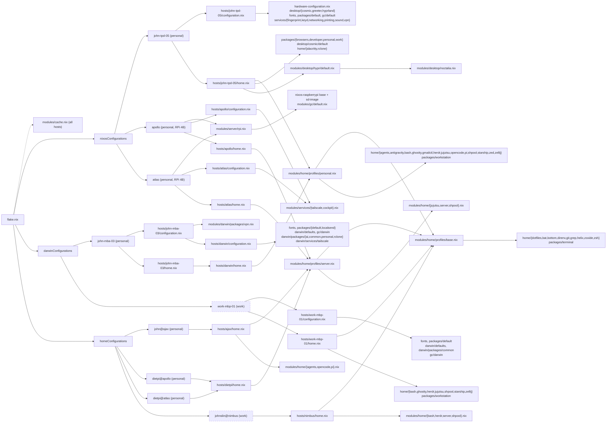

# infra

Everything is computer

## Runbooks

Full install procedures for a blank disk or a fresh macOS live in [docs/runbooks/](./docs/runbooks/README.md). Start with the index there to pick the runbook for your machine. The commands below are the quick reference for machines that are already bootstrapped.

## Machines and ownership

Every flake output is either a personal machine or a work machine, and personal configuration may not leak into the work ones: work hosts import `modules/home/profiles/base.nix` and neutral leaf modules only, never `hosts/darwin`, `profiles/personal.nix`, or `profiles/server.nix`. The machine map, the airgap rules, and the validation contract are in [AGENTS.md](./AGENTS.md).

### Module graph



## Bootstrap (First Time Setup)

Since `just` is installed via this Nix configuration, it won't be available on the first run. Use one of these methods to bootstrap:

### Option 1: Use `nix run` with `just`

Run `just` directly from nixpkgs without installing it:

```bash
# On NixOS
nix run nixpkgs#just -- nr <hostname>

# On Linux with Home Manager (standalone)
nix run nixpkgs#just -- hm <username>@<hostname>

# For hosts requiring impure evaluation (e.g., johnslin@nimbus)
nix run nixpkgs#just -- hm johnslin@nimbus --impure
```

### Option 2: Use raw Nix commands

Bypass `just` entirely for the first rebuild (required on macOS before `darwin-rebuild` is installed, or before `home-manager` is available):

```bash
# On macOS (bootstrap)
nix run nix-darwin/master -- switch --flake .#<hostname>

# On NixOS
sudo nixos-rebuild switch --flake .#<hostname>

# On Linux with Home Manager (standalone, non-NixOS)
nix run home-manager -- switch --flake .#<username>@<hostname> -b bak

# For hosts requiring impure evaluation (e.g., johnslin@nimbus)
nix run home-manager -- switch --flake .#johnslin@nimbus --impure -b bak
```

> [!NOTE]
> If your Nix installation doesn't have flakes enabled globally yet, add `--extra-experimental-features "nix-command flakes"` to any `nix` command.

After the first successful rebuild, `just` (and `darwin-rebuild` on macOS) will be installed and available for all subsequent commands.

## NixOS

To rebuild, run

```bash
just nr <hostname>
```

## macOS

To rebuild, run

```bash
just dr <hostname>
```

## Home Manager (Standalone Linux)

For standalone Home Manager on non-NixOS Linux systems (e.g., AlmaLinux, Ubuntu with Nix installed):

To rebuild, run:

```bash
just hm <username>@<hostname>
```

For example, to apply the configuration for `john@ajax`:

```bash
just hm john@ajax
```

The `hm` command in the `justfile` accepts a host followed by native Home Manager options. It always uses `-b bak` for the normal backup behavior and defaults to `dietpi@atlas`.

To apply the configuration for `johnslin@nimbus` (which requires impure mode), pass `--impure` directly:

```bash
just hm johnslin@nimbus --impure
```

For other hosts that don't need impure mode, you can just pass the host name:

```bash
just hm john@ajax
```

If you need to run it manually without `just` (e.g., for bootstrapping):

```bash
nix run home-manager -- switch --flake .#<username>@<hostname> -b bak
```

And for `nimbus` specifically:

```bash
nix run home-manager -- switch --flake .#johnslin@nimbus --impure -b bak
```

## Garbage Collection

To collect garbage, run

```bash
just clean
```

Default is 30 days. To specify a different number of days:

```bash
just clean <days>
```

## Updating Packages

Updating packages is as easy as

```bash
just update
```

which will update your `flake.lock` file.

## Upgrade and Push

`just upgrade` is the only supported way to publish a lock update. It fetches, rebases the working copy onto `main@origin`, runs `nix flake update`, **runs `just check-all`**, then commits `flake.lock`, moves the `main` bookmark, and pushes. A lock update that breaks evaluation of any host therefore cannot be pushed.

```bash
just upgrade
```

The commit message defaults to `chore: update flake`; pass one to override it:

```bash
just upgrade "chore: bump nixpkgs"
```

## Validation

Two gates, different scopes:

```bash
just check       # this machine: nix flake check, evaluates and builds its checks
just check-all   # every output, every architecture: evaluation only
```

- `just check` is what you run while working on a host: `nix flake check` realises and builds the checks for the machine you are on, so it catches package build failures. It never looks at the other hosts.
- `just check-all` is the pre-push gate: it evaluates the `drvPath` of every NixOS, nix-darwin, and standalone Home Manager output, on any architecture. Evaluation only, so nothing is built and inputs are already locked, but each host costs a few seconds (about 45 s for all seven here).

The two overlap but catch different failures: a package can evaluate and fail to build (only `just check` sees that), and another architecture's output can be broken while this machine's is fine (only `just check-all` sees that). `just upgrade` runs `just check-all` for you.

Neither gate proves activation or runtime behaviour: run the host's own `nixos-rebuild build`, `darwin-rebuild build`, or `home-manager build` before switching.

## Additional Setup

### rclone

`rclone` is used to sync cloud storage to local drives. The configuration is pretty much ready to go, except you need to sign in to get access tokens to OneDrive and Google Drive.
Refer to [docs/cloud-storage.md](./docs/cloud-storage.md) for more info.

### gmailctl

`gmailctl` and its `~/.gmailctl/config.jsonnet` filter config are managed declaratively with Home Manager.
Refer to [docs/gmailctl.md](./docs/gmailctl.md) for setup and operational details.

## Troubleshooting

### Ghostty Terminfo Issues

If you experience garbled terminal output or repeated characters when SSH'ing into servers, see [docs/terminfo-troubleshooting.md](./docs/terminfo-troubleshooting.md) for diagnosis and solutions.
